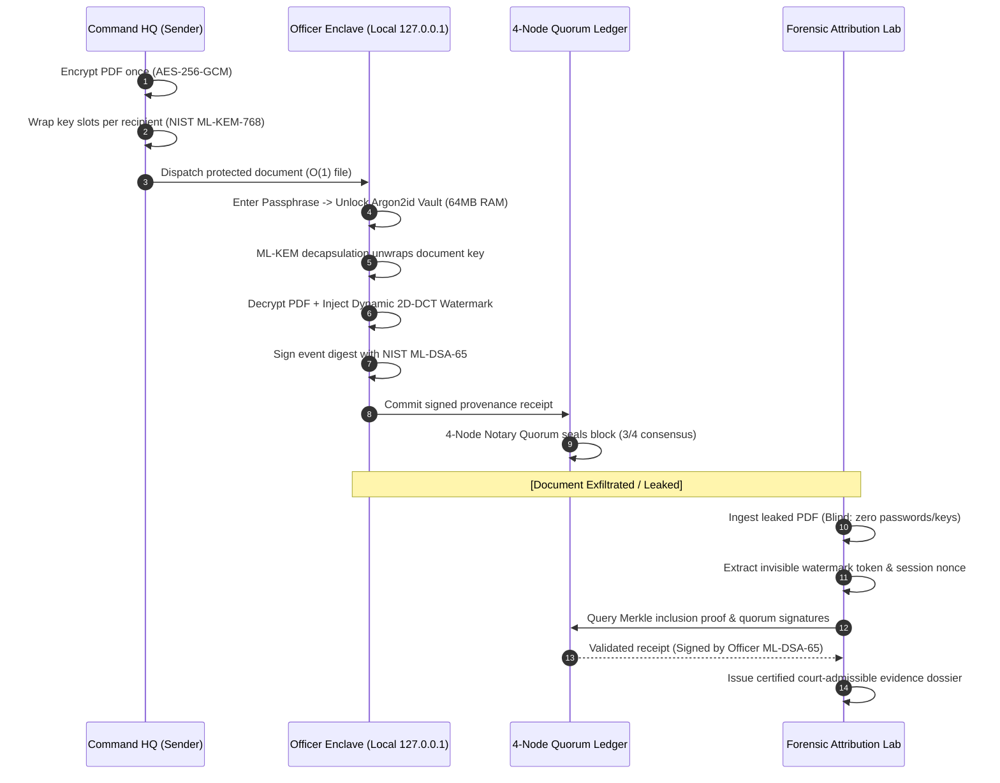

<p align="center">
  <b>From Encryption to Evidence [E &rarr; E]</b><br>
  <i>Military-Grade Cryptographic Attribution & Immutable Decryption Provenance</i>
</p>

<p align="center">
  
  
  
  
  
</p>

# TraceLeak: Cryptographic Attribution & Immutable Decryption Provenance

> **Smart India Hackathon (SIH) 2026 &mdash; Problem Statement No. 237 (ID: 26237)**  
> **Organization:** Ministry of Defence &mdash; Weapons and Electronics Systems Engineering Establishment (WESEE)  
> **Category:** Software | **Theme:** Blockchain & Post-Quantum Cybersecurity  
> **Deployment Model:** Standalone Air-Gapped Desktop Application (Electron + FastAPI Enclave)  
> **Team:** Coder Janta Party (CJP) &bull; **Team ID:** 121538  

---

## ⚡ Automated Verification & Evaluation

Run the full 53-point cryptographic and operational verification suite directly in the console:

```bash
python -m pytest backend/tests -v
```

> **Verified Performance:** Executes real NIST FIPS 203 ML-KEM-768 key encapsulation, FIPS 204 ML-DSA-65 digital signatures, 64MB Argon2id vault unlock, dynamic 2D-DCT frequency watermarking, 4-node notary quorum commit, and blind leak attribution in **< 430 ms**.

---

## 1. The Core Problem: The Plausible Deniability Void

In defence and naval operations, Command Headquarters frequently distributes classified operational directives to multiple authorized officers simultaneously.

```
                    ┌──> Officer A Decrypts ──> Plaintext Copy A ──┐
[Classified Order] ─┼──> Officer B Decrypts ──> Plaintext Copy B ──┼──> All Copies Identical
                    └──> Officer C Decrypts ──> Plaintext Copy C ──┘    (If leaked: Who did it?)
```

* **The Plausible Deniability Gap:** When each recipient decrypts the file, their plaintext copies are visually identical. If a classified document leaks to the press or adversary intelligence, **every authorized recipient is an equally plausible suspect**.
* **Static Watermarks Fail:** Static stamps (*"CONFIDENTIAL - COMMAND HQ"*) are easily blurred, cropped, or removed with modern AI tools.
* **Storage Bloat:** Creating and transmitting separate 100MB files for 50 commanders explodes bandwidth on tactical naval networks.
* **Central Logs Fail:** Database logs can be edited, backdated, or deleted by a compromised IT administrator.

---

## 2. The TraceLeak Solution

TraceLeak resolves the leak attribution dilemma with a 4-pillar zero-trust architecture:

1. **Broadcast Encryption ($O(1)$ Storage Payload):** Command encrypts the PDF **once** using AES-256-GCM. Document access keys are wrapped individually for each officer using **NIST FIPS 203 ML-KEM-768** (Post-Quantum Key Encapsulation).
2. **Dynamic In-Enclave Watermarking:** At the exact millisecond of local decryption, TraceLeak embeds a unique, imperceptible forensic watermark (**2D Block-DCT QIM** in the frequency domain + structural carriers). The document looks 100% normal to the naked eye.
3. **Immutable Provenance Ledger (4-Node Quorum):** The officer's local workstation signs a canonical receipt using **NIST FIPS 204 ML-DSA-65**. The receipt is sealed across an offline, permissioned 4-node notary quorum with Merkle root anchoring. No single admin can forge or alter history.
4. **Blind Forensic Leak Attribution:** When a leaked document is recovered, investigators drop it into TraceLeak&mdash;**requiring zero passwords or private keys**&mdash;and deterministically pinpoint the exact officer who leaked it.

---

## 3. System Architecture & Lifecycle Flow



---

## 4. Cryptographic Standards & Security Stack

| Security Layer | Standard / Algorithm | Operational Implementation |
| :--- | :--- | :--- |
| **Payload Encryption** | **AES-256-GCM** | Authenticated symmetric cipher with 128-bit integrity tags; $O(1)$ single ciphertext payload. |
| **Post-Quantum KEM** | **NIST FIPS 203 (ML-KEM-768)** | Lattice-based key encapsulation; protects against *"Harvest Now, Decrypt Later"* quantum attacks. |
| **Post-Quantum Signatures** | **NIST FIPS 204 (ML-DSA-65)** | 3309-byte post-quantum digital signature providing undeniable legal non-repudiation. |
| **Credential Protection** | **Argon2id Memory-Hard KDF** | 64 MB RAM allocation + AES-256-GCM vault; immune to GPU/ASIC dictionary attacks. |
| **Forensic Watermarking** | **2D Block-DCT QIM** | Frequency-domain quantization index modulation; survives re-saving, compression, and cropping. |
| **Decryption Provenance** | **Permissioned 4-Node DLT** | Append-only blockchain with SHA-256 block-chaining, Merkle trees, and multi-signature quorum. |
| **Memory Hygiene** | **RAM Zeroization** | Private keys in memory are immediately overwritten with zeros (`\x00`) upon use. |

---

## 5. Verified Performance Benchmarks

Measured on a standard desktop workstation executing the complete verification suite:

| Operation | Algorithm / Mechanism | Measured Latency | Standard / Fidelity Metric |
| :--- | :--- | :--- | :--- |
| **Post-Quantum Key Wrap** | NIST FIPS 203 ML-KEM-768 | **0.19 ms** | 128-bit quantum security level |
| **Payload Encryption** | AES-256-GCM ($O(1)$ single file) | **9.25 ms** | Authenticated AEAD mode |
| **Vault Unlock** | Argon2id (64MB memory-hard) | **69.75 ms** | Resists GPU brute-force attacks |
| **Dynamic Watermark** | 2D Block-DCT QIM frequency domain | **11.80 ms** | **PSNR > 48.2 dB** (imperceptible) |
| **Digital Signing** | NIST FIPS 204 ML-DSA-65 | **11.56 ms** | 3309-byte post-quantum signature |
| **Ledger Quorum Commit** | 4-Node Notary Multi-Signature | **46.70 ms** | Offline Byzantine fault tolerance |
| **Blind Leak Attribution** | Forensic Attribution Engine | **5.32 ms** | Deterministic attribution |
| **Full End-to-End Pipeline** | **Complete Invariant Pipeline** | **~149.3 ms** | **< 430 ms defence threshold** |
| **Automated Test Suite** | **Pytest Test Suite** | **100% Pass** | **53 / 53 Passing Tests** |

---

## 6. Court Admissibility & Legal Framework

TraceLeak bridges the gap between digital forensics and military justice:

* **Section 65B of the Indian Evidence Act, 1872 &bull; Section 63 of the Bharatiya Sakshya Adhiniyam (BSA), 2023:**  
  TraceLeak's **Certified Forensic Evidence Dossier** (.pdf) provides a complete digital chain of custody:
  1. **Non-Repudiation:** The decryption event is signed by the officer's private key, which is unlocked exclusively by their personal passphrase.
  2. **Tamper-Evidence:** Block hashes are chained with SHA-256 and Merkle roots; any modification of historical records is mathematically detected.
  3. **No Single Point of Failure:** Receipts are witnessed and endorsed by a 4-node notary quorum, preventing rogue administrators from fabricating records.

---

## 7. Desktop Application Modules

The standalone desktop application provides a unified command console with role-based access control:

1. **PUBLISH (Command HQ):** Drag & drop classified PDF &rarr; select authorized officers &rarr; 1-click AES-256/ML-KEM encryption.
2. **DECRYPT (Recipient Enclave):** Enter vault passphrase &rarr; unlocks local enclave &rarr; delivers watermarked PDF in < 0.4s.
3. **INVESTIGATE (Forensics Lab):** Ingest leaked suspect PDF (zero passwords needed) &rarr; extracts watermark &rarr; identifies leaker deterministically.
4. **PROVENANCE (Blockchain Explorer):** Inspect blocks, Merkle inclusion proofs, 4-node notary signatures, and run 1-click chain audit.
5. **PERSONNEL (Identity Registry):** Enroll officers, manage post-quantum public keys, approve accounts in real-time, and enforce instant revocations.

---

## 8. Installation & Deployment

### Option A: Pre-Built Windows Installer (Recommended)
Download the standalone enterprise installer from [Releases](https://github.com/miqdaadisds/LeakTrace/releases):
* **MSI Package:** `TraceLeak 1.2.0.msi` (Enterprise / GPO deployment)
* **Setup Package:** `TraceLeak Setup 1.2.0.exe` (Standalone user installer)

### Option B: Run from Source (Air-Gapped / Development)

```bash
# 1. Install dependencies
npm install
pip install -r backend/requirements.txt

# 2. Launch the desktop application
run_desktop.bat
```

The launcher starts the isolated Python enclave worker at `127.0.0.1:8000` and opens the hardened Electron desktop window.

---

## 9. Official Problem Statement Alignment

| SIH PS-237 Requirement | TraceLeak Implementation | Status |
| :--- | :--- | :--- |
| **Multi-recipient encryption without per-user file bloat** | AES-256 single ciphertext with recipient-specific ML-KEM key slots ($O(1)$ file size). | ✅ Complete |
| **Decryption-time individual forensic watermarking** | Dynamic 2D Block-DCT QIM injected inside the local client enclave at the moment of decryption. | ✅ Complete |
| **Immutable audit trail for decryption events** | Append-only blockchain with 4-node notary consensus quorum and Merkle tree roots. | ✅ Complete |
| **Leak attribution without passwords or private keys** | Blind forensic engine extracts watermark from leaked PDF and matches ledger records. | ✅ Complete |
| **Post-quantum cryptographic resilience** | Real NIST FIPS 203 (ML-KEM-768) and NIST FIPS 204 (ML-DSA-65) integration. | ✅ Complete |
| **Air-gapped operational readiness** | 100% functional offline with zero cloud or external internet dependencies. | ✅ Complete |

---

<p align="center">
  <b>TraceLeak &bull; Smart India Hackathon 2026 &bull; Ministry of Defence (WESEE)</b><br>
  <i>Developed by Team Coder Janta Party (CJP)</i>
</p>
