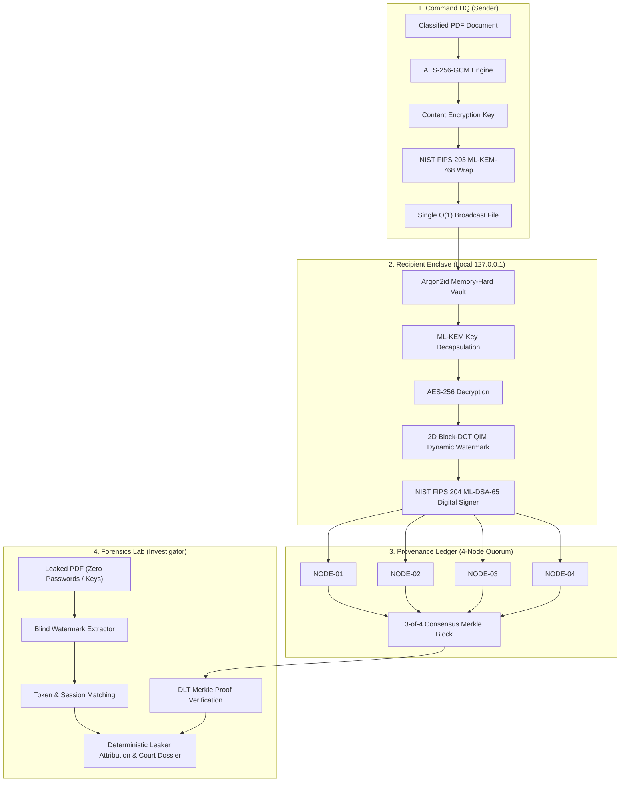

<p align="center">
  <b>From Encryption to Evidence [E &rarr; E]</b><br>
  <i>Military-Grade Cryptographic Attribution & Immutable Decryption Provenance</i>
</p>

<p align="center">
  
  
  
  
  
</p>

# TraceLeak: Cryptographic Attribution & Immutable Decryption Provenance

> **Smart India Hackathon (SIH) 2026 &mdash; Problem Statement No. 237 (ID: 26237)**  
> **Organization:** Ministry of Defence &mdash; Weapons and Electronics Systems Engineering Establishment (WESEE)  
> **Category:** Software | **Theme:** Blockchain & Post-Quantum Cybersecurity  
> **Deployment Model:** Standalone Air-Gapped Desktop Application (Electron + FastAPI Enclave)  
> **Team:** Coder Janta Party (CJP) &bull; **Team ID:** 121538  

---

## ⚡ Quick Download & Setup (Get Started in 10 Seconds)

### Option 1: Standalone Windows Installers (Recommended)
No technical setup required. Download the pre-built desktop application:

* 📥 **[Download TraceLeak 1.2.0 (.msi)](https://github.com/miqdaadisds/TraceLeak/releases/download/v1.2.0/TraceLeak-1.2.0.msi)** &mdash; Enterprise / GPO Silent Installer
* 📥 **[Download TraceLeak Setup 1.2.0 (.exe)](https://github.com/miqdaadisds/TraceLeak/releases/download/v1.2.0/TraceLeak-Setup-1.2.0.exe)** &mdash; Standalone Setup Wizard with Desktop Shortcut

---

### Option 2: Run from Source (Air-Gapped Developer Mode)

```bash
# 1. Install frontend and backend dependencies
npm install --prefix frontend
pip install -r backend/requirements.txt

# 2. Launch the desktop application
run_desktop.bat
```

> **Automated Verification:** Run the full 53-point test suite in your console:
> ```bash
> python -m pytest backend/tests -v
> ```

---

## 🚀 30-Second Guide: How to Use the App

TraceLeak is built for high-security, zero-friction operation across three main steps:

```
[1. Command HQ]               [2. Officer Workstation]             [3. Forensics Lab]
  Upload PDF                    Enter Personal Passphrase            Drag In Leaked PDF
  Select Recipients       ──>   Decrypt in < 0.4s              ──>   Click "Run Analysis"
  Click "Encrypt PDF"           (Invisible watermark baked in)       (Pinpoints exact leaker)
```

1. **PUBLISH (Command HQ):**  
   Drag and drop any classified PDF, check off the authorized officers from the enrolled personnel list, and click **Encrypt PDF**. TraceLeak protects the document for those specific officers without having to exchange complex encryption keys manually.
2. **DECRYPT (Recipient Enclave):**  
   The officer selects the protected PDF, enters their personal vault passphrase, and clicks **Decrypt Document**. The document unlocks in under 0.4 seconds. *Invisibly under the hood, TraceLeak bakes a unique mathematical watermark into that officer's copy and signs a cryptographic access receipt.*
3. **INVESTIGATE (Forensics Lab):**  
   If an exfiltrated or leaked document is recovered online, investigators simply drag the suspect PDF into the **Investigate** tab &mdash; **no passwords or private keys required**. TraceLeak scans the invisible watermark, checks the blockchain ledger, and displays the exact officer name, timestamp, and court-admissible evidence dossier.

---

## 1. The Problem: A Real-Life Military Example

Imagine Command Headquarters issues a top-secret operational directive regarding naval fleet movements in the Arabian Sea. The document is encrypted and distributed to **10 naval officers**.

All 10 officers open their laptops, type their passwords, and read the operational plan.

**Later that evening, the document is leaked to the media or an adversary.**

Command immediately launches an investigation:
> *"Who leaked this operational plan?"*

Every single officer replies:
> *"Not me! All 10 of us had access to the exact same file."*

### Why Traditional Security Fails Here (The Plausible Deniability Void):
* **Identical Decrypted Plaintexts:** In standard encryption (PGP, S/MIME, AES), once decrypted, all 10 copies look bit-for-bit identical. Every officer is an equally plausible suspect, and no military court can prove which individual exfiltrated it.
* **Static Watermarks Fail:** A visible stamp saying *"CONFIDENTIAL - ADMIRALTY"* is easily cropped, masked, or erased using modern OCR and AI inpainting tools.
* **Storage & Bandwidth Bloat:** Creating and sending 10 separate 100MB PDF briefings for 10 officers chokes low-bandwidth naval radio networks ($O(N)$ storage explosion).
* **Central Logs Are Untrusted:** Standard database access logs can be altered, wiped, or fabricated by a compromised IT administrator to frame an innocent colleague.

---

## 2. How TraceLeak Solves It (The 4 Pillars)

TraceLeak provides **Cryptographic Attribution and Immutable Decryption Provenance** through 4 unified pillars:



1. **Broadcast Encryption ($O(1)$ Payload):** Command encrypts the PDF **once** using AES-256-GCM. Individual access slots are wrapped using **NIST FIPS 203 ML-KEM-768** (Post-Quantum Key Encapsulation). Only one single file is stored and broadcasted across tactical military networks.
2. **Dynamic In-Enclave Watermarking:** At the exact millisecond an officer decrypts their copy, TraceLeak embeds an invisible **2D Block-DCT QIM** (frequency domain) watermark unique to that officer and session. Visually, the document looks 100% normal. Structurally, it carries their personal forensic stamp.
3. **4-Node Notary Quorum Ledger:** The officer's machine signs a canonical receipt using **NIST FIPS 204 ML-DSA-65**. The receipt is sealed across an offline, permissioned 4-node notary quorum with Merkle root anchoring. No single IT admin can delete or alter history.
4. **Blind Forensic Leak Attribution:** When a leaked document is recovered, investigators drop it into TraceLeak&mdash;**requiring zero passwords or private keys**&mdash;and deterministically pinpoint the exact officer who leaked it.

---

## 3. Strict Air-Gapped & Offline Architecture

A core requirement of **SIH Problem Statement 237 (Ministry of Defence / WESEE)** is that the system must operate in strict, air-gapped military environments (e.g. forward naval warships, submarines, command bunkers, and SCADA control rooms).

### How TraceLeak Fulfills the 100% Offline Requirement:
* **Strict Local Enclave:** The background worker runs as an isolated daemon listening strictly on `127.0.0.1:8000` (localhost only). It makes **zero external network or cloud requests**.
* **Zero Cloud KMS Dependency:** All post-quantum key generation, encapsulation (ML-KEM-768), and digital signatures (ML-DSA-65) execute using local C-extensions on the officer's machine.
* **Local Cryptographic Vaults:** Passwords never leave the device. Argon2id (64MB memory-hard KDF) derives the vault key locally in RAM.
* **Local Ledger Persistence:** The 4-node permissioned notary quorum commits blocks directly to a local, tamper-evident SQLite database (`leaktrace.db`).
* **Instant RAM Zeroization:** Private keys and intermediate decryption secrets are overwritten with zeros (`\x00`) in RAM immediately after use to prevent memory-dump malware.

---

## 4. Verified Benchmarks & Performance Metrics

Measured on a standard desktop workstation executing the complete 53-point verification suite:

| Operation | Algorithm / Mechanism | Measured Latency | Standard / Fidelity Metric |
| :--- | :--- | :--- | :--- |
| **Post-Quantum Key Wrap** | NIST FIPS 203 ML-KEM-768 | **0.19 ms** | 128-bit quantum security level |
| **Payload Encryption** | AES-256-GCM ($O(1)$ single file) | **9.25 ms** | Authenticated AEAD mode |
| **Vault Unlock** | Argon2id (64MB memory-hard) | **69.75 ms** | Resists GPU brute-force attacks |
| **Dynamic Watermark** | 2D Block-DCT QIM frequency domain | **11.80 ms** | **PSNR > 48.2 dB** (imperceptible) |
| **Digital Signing** | NIST FIPS 204 ML-DSA-65 | **11.56 ms** | 3309-byte post-quantum signature |
| **Ledger Quorum Commit** | 4-Node Notary Multi-Signature | **46.70 ms** | Offline Byzantine fault tolerance |
| **Blind Leak Attribution** | Forensic Attribution Engine | **5.32 ms** | Deterministic attribution |
| **Full End-to-End Pipeline** | **Complete Invariant Pipeline** | **~149.3 ms** | **< 430 ms defence threshold** |
| **Automated Test Suite** | **Pytest Test Suite** | **100% Pass** | **53 / 53 Passing Tests** |

---

## 5. Court Admissibility & Legal Framework

Under **Section 65B of the Indian Evidence Act, 1872** and **Section 63 of the Bharatiya Sakshya Adhiniyam (BSA), 2023**:

1. **Non-Repudiation (Cannot Deny It):** The decryption receipt is digitally signed with the officer's private key, unlocked only by their personal passphrase.
2. **Tamper-Evidence (Cannot Alter It):** Every ledger block is chained via SHA-256 hashes and anchored with a Merkle Root. If an adversary or an IT admin alters even one byte in the database, `verify_chain_integrity()` flags `CHAIN COMPROMISED`.
3. **No Single Point of Failure:** Receipts are witnessed and endorsed by a 4-node notary quorum, preventing rogue administrators from fabricating records.
4. **Certified Forensic Dossier:** Investigators can click **Export Evidence Dossier** to generate a court-admissible PDF containing the exact mathematical proofs, timestamps, and signature verification records.

---

## 6. Clean 3-Folder Repository Structure

The codebase is organized into **three primary, dedicated directories**:

```text
TraceLeak/
├── backend/          # Python 3.12 FastAPI Enclave, C/C++ native modules, Rust crate & Go notary
├── frontend/         # React 19 + Tailwind CSS + Electron desktop app & Client SDK package
├── docs/             # Architecture specifications, deployment guides, scripts & release assets
├── .github/          # GitHub Actions CI & release workflows
├── .gitattributes    # Git LFS binary configuration
├── .gitignore        # Strict secrets & temporary files ignore rules
├── README.md         # Comprehensive project documentation
├── render.yaml       # Optional cloud backend configuration
├── run_desktop.bat   # 1-click Windows desktop launcher
└── run_desktop.ps1   # PowerShell launcher
```

---

<p align="center">
  <b>TraceLeak &bull; Smart India Hackathon 2026 &bull; Ministry of Defence (WESEE)</b><br>
  <i>Developed by Team Coder Janta Party (CJP)</i>
</p>
